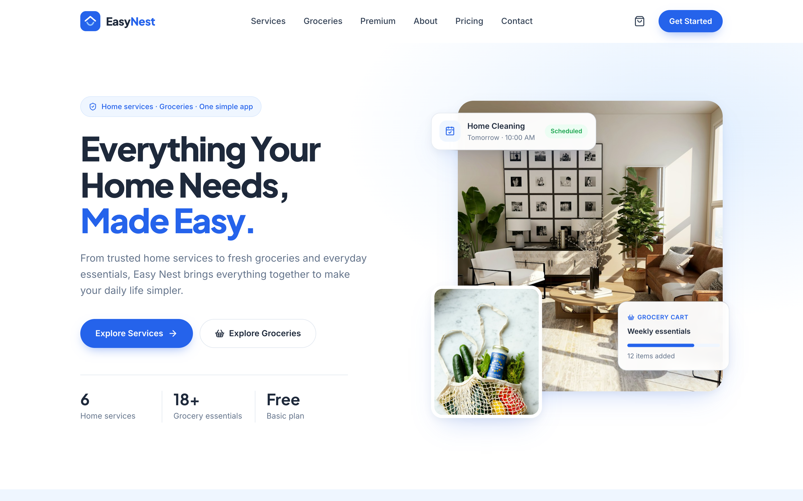
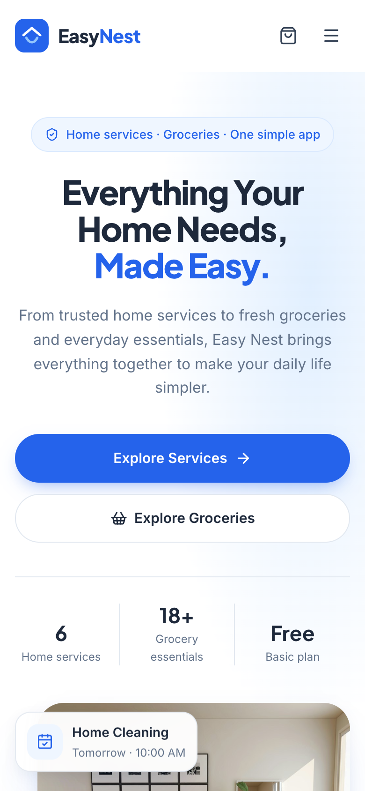
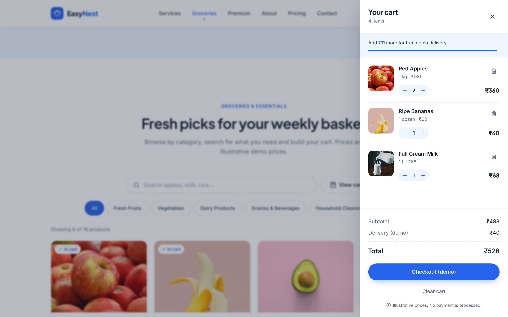

# Easy Nest

**Everything Your Home Needs, Made Easy.**

Easy Nest is a responsive SaaS landing page for a conceptual platform that brings **home services** and **grocery shopping** together in one place, with a **Premium** plan for family sharing and scheduled orders.

> This is a front-end-only demo. There is no backend, database, login or payment. Bookings, sign-ups, checkout and contact messages are simulated in the browser and are clearly labelled as demos. Prices are illustrative.



| Mobile | Cart drawer |
| --- | --- |
|  |  |

---

## Features

**Sections**
| Section | What it contains |
| --- | --- |
| Navigation bar + Sign Up / Get Started | Sticky navbar with logo, section links, cart count and **Get Started**. It highlights the section you are viewing and becomes a hamburger menu on mobile. |
| Hero | Headline, description, two call-to-action buttons, and a photo with small floating UI cards |
| Features (3 or more) | **Home Services** (6 services), **Groceries** (18 sample products) and **Premium** (family sharing and scheduled orders) |
| About / How it works | One About section with a short intro and a 3-step guide (Explore, Choose, Simplify) |
| Pricing (2 or more plans) | Basic (Free) and Premium, with a working monthly/yearly toggle |
| Contact / Footer | Validated contact form, placeholder contact details, and a footer |

**Working interactions (all frontend)**
- **Book Now**: opens a booking form with the clicked service already selected. It validates name, a 10-digit phone number and a future date, then shows a confirmation.
- **Groceries**: category filter chips, a search box, an empty state when nothing matches, and a "Show all" button.
- **Shopping cart drawer**: add, increase, decrease, remove and clear items, with live totals and a demo checkout message. The cart is saved in `localStorage`.
- **Get Started / Choose plan**: opens a sign-up form with email validation and a success message. Choosing a pricing plan pre-selects it.
- **Contact form**: required fields, email check, an optional phone check, clear error messages, and a success state.
- Small feedback messages (for example "Added to cart"), a back-to-top button and smooth scrolling.

**Premium** (family sharing and scheduled orders) is described in words as an upcoming plan feature. It is not an active feature on this site.

**Responsive design**: tested from 320 px to 1440 px wide with no horizontal scrolling. Pop-up forms become bottom sheets on phones, and the category chips scroll sideways.

## Technologies

- **React 19** (functional components and hooks)
- **Vite 6** (dev server and production build)
- **JavaScript (ES6+)**
- **CSS3**: custom properties (design tokens), Grid, Flexbox and media queries. No CSS framework.
- **Lucide React** for icons
- Google Fonts: *Plus Jakarta Sans* for headings and *Inter* for body text

## Getting started

Requirements: **Node.js 18+** and npm.

```bash
# 1. Install dependencies
npm install

# 2. Start the development server
npm run dev
# open the URL shown in the terminal (usually http://localhost:5173)
```

## Build for production

```bash
npm run build     # outputs an optimised site to /dist
npm run preview   # serves /dist locally to check the build
npm run lint      # runs ESLint
```

## Deployment

The site is static, so any static host works.

**Vercel**
1. Push this folder to a GitHub repository.
2. Go to vercel.com, choose **Add New → Project**, and import the repository.
3. Vercel detects Vite automatically. The build command is `npm run build` and the output directory is `dist`.
4. Click **Deploy**.

**Netlify**
1. Go to app.netlify.com and choose **Add new site → Import an existing project**, then pick the repository.
2. Set the build command to `npm run build` and the publish directory to `dist`, then deploy.
   (Or run `npm run build` and drag the `dist` folder onto Netlify Drop.)

## Project structure

```
easy-nest/
├── public/
│   └── favicon.svg             # Easy Nest logo mark
├── screenshots/                # Desktop and mobile screenshots
├── src/
│   ├── assets/images/          # Locally stored photos
│   ├── components/             # One component per section, each with its own CSS
│   │   ├── Navbar.jsx          # Sticky nav, active link, mobile menu
│   │   ├── Hero.jsx
│   │   ├── HomeServices.jsx    # 6 service cards
│   │   ├── BookingModal.jsx    # Demo booking form + validation
│   │   ├── Groceries.jsx       # Category filter + search
│   │   ├── ProductCard.jsx
│   │   ├── Cart.jsx            # Cart drawer
│   │   ├── SmartManagement.jsx # Premium: family sharing + scheduled orders
│   │   ├── About.jsx           # About intro + How it works
│   │   ├── HowItWorks.jsx      # 3 steps
│   │   ├── Pricing.jsx
│   │   ├── Contact.jsx
│   │   ├── Footer.jsx
│   │   ├── SignupModal.jsx     # Get Started form
│   │   ├── Modal.jsx           # Reusable pop-up dialog
│   │   ├── Toast.jsx           # Feedback messages
│   │   ├── BackToTop.jsx
│   │   ├── Reveal.jsx          # Scroll-in animation wrapper
│   │   ├── SectionHeader.jsx   # Shared section heading
│   │   ├── SafeImage.jsx       #  with a fallback
│   │   └── Logo.jsx
│   ├── data/                   # Sample content: products, services, nav links, plans
│   ├── hooks/                  # useInView, useActiveSection
│   ├── utils/validation.js     # Email/phone validation, price formatting
│   ├── App.jsx                 # Shared state: cart, pop-ups, toasts
│   ├── App.css
│   ├── index.css               # Design tokens, base styles, buttons, forms
│   └── main.jsx
├── index.html
├── package.json
└── vite.config.js
```

## Design system

| Token | Value | Used for |
| --- | --- | --- |
| Royal Blue | `#2563EB` | Primary buttons, brand, highlights |
| White | `#FFFFFF` | Dominant background, cards |
| Ice Blue | `#EFF6FF` | Alternate section backgrounds |
| Soft Blue | `#93C5FD` | Accents |
| Charcoal | `#334155` | Body text |
| Border | `#E2E8F0` | Card and input borders |

All cards share the same corner radius (16–24 px) and soft, blue-tinted shadows.

## Notes

- All content is sample content. Contact details are placeholders and prices are illustrative.
- Photos are sample images stored locally in `src/assets/images`.
- No API keys, passwords or credentials are used anywhere in the project.
